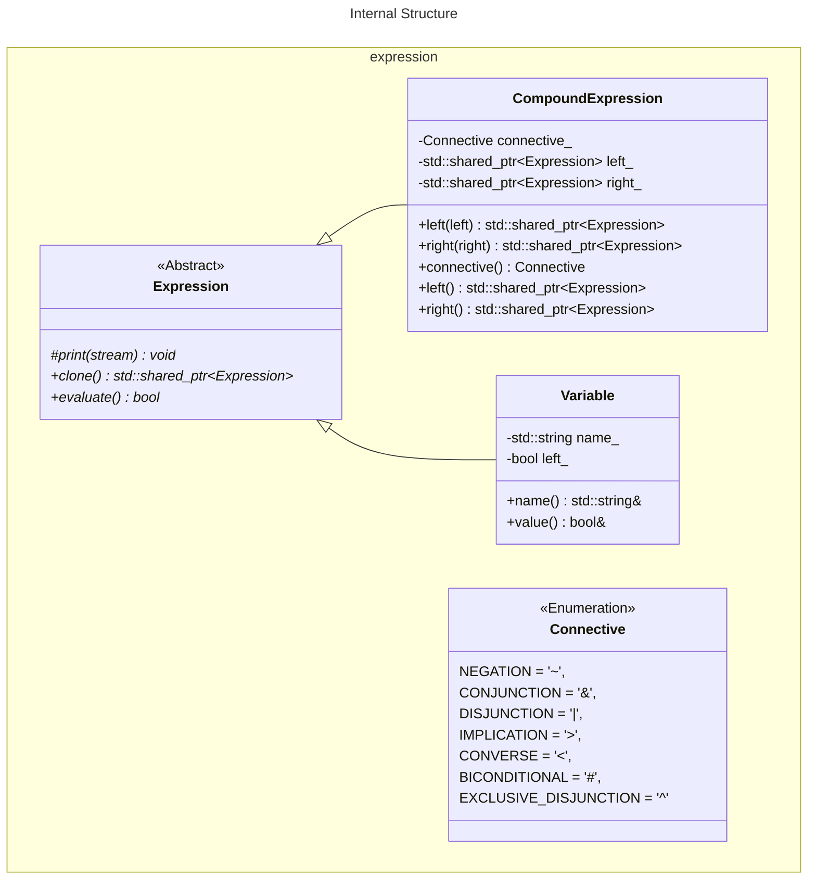

# Deematherializer - Propositional Logic System

I was inspired by one of my university classes (CS 311: Discrete Math for CS) to create a propositional logic system, and hopefully, some inkling of a proof assistant.

# Getting Started

## Building

The build system employs [cmake](https://cmake.org/cmake/help/latest/). To construct the build system, run `cmake -S . -B build/`.

- Include the flag `-DCMAKE_EXPORT_COMPILE_COMMANDS=ON` if interested in exporting compiler flags to `build/compiler_commands.json` (and ensuring compatibility with clangd).
- Include the flag `-DBUILD_TESTING=ON` if interested in running tests and debugging (See [Testing](#Testing))

Then, to run the build system, run `cmake --build build/`

## Testing

Tests are implemented using [googletest](https://google.github.io/googletest/) and ran with [ctest](https://cmake.org/cmake/help/latest/manual/ctest.1.html).

- Tests are to be placed in `/*/tests` and, using regular expressions, select ones can be ran after a build with `ctest --test-dir -R 'regexMatchingTests' build/`.
- All tests stored in `/*/tests` be ran after a debug build with `ctest --test-dir build/`

# Structure and Usage

# AI Disclaimer

I have used AI to learn how to implement C++ features, especially smart pointers (`std::shared_ptr`) and inheritance/polymorphism, as well as to better understand developer tools like Google's googletest, CMake, and CTest.
